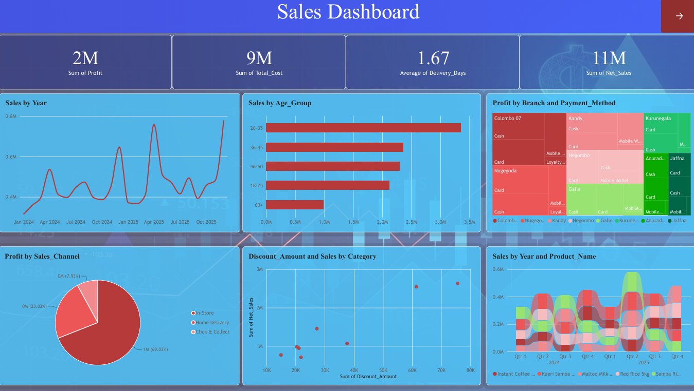
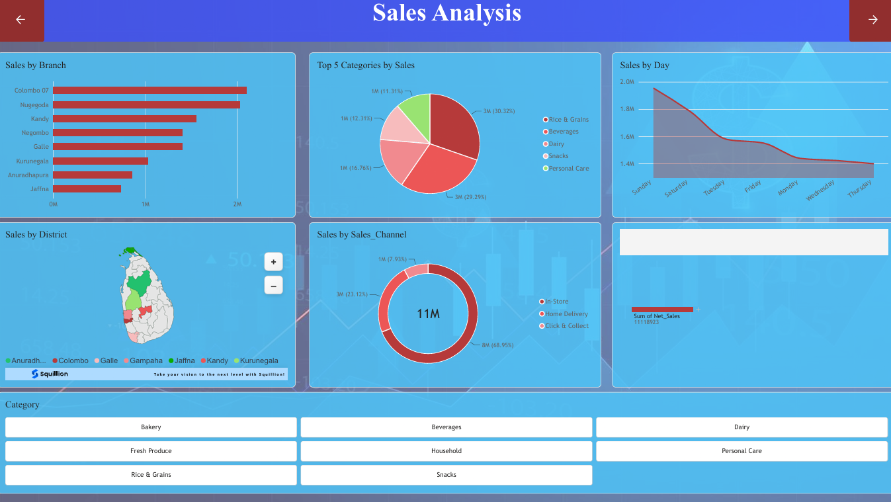
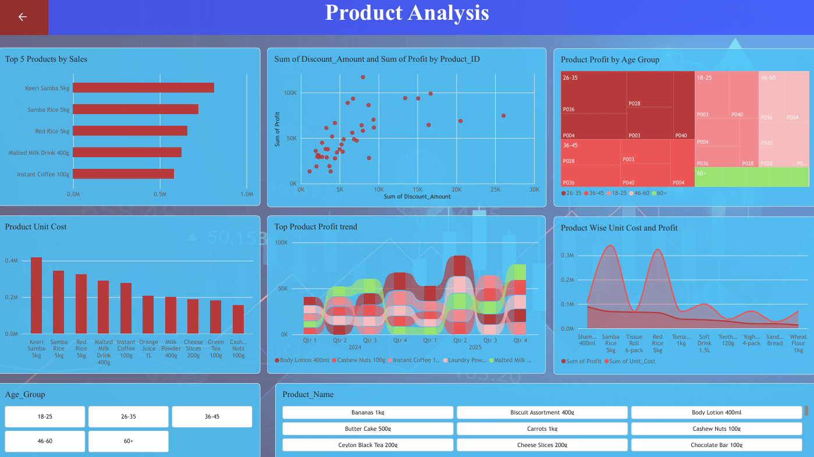

# Retail Sales Dashboard (Power BI)

## Overview
A multi-page Power BI dashboard analyzing sales performance across branches, customer age groups, sales channels and products for a retail business in Sri Lanka.

## Business Questions
- How are sales and profit trending over time?
- Which branches, payment methods and sales channels generate the most profit?
- Which customer age groups buy the most?
- How do discounts relate to sales across product categories?
- Which products perform best each quarter?

## Dashboard Pages
1. **Dashboard:** summary of key numbers and overview charts
2. **Sales Analysis:** detailed look at sales performance
3. **Product Analysis:** detailed look at product performance

## Key Metrics
| Metric | Value |
|---|---|
| Net Sales | 11M |
| Total Cost | 9M |
| Profit | 2M |
| Average Delivery Time | 1.67 days |

## Key Insights
- In-store sales generate the largest share of profit (about 69%), ahead of home delivery and click & collect.
- The 26-35 age group is the highest-spending customer segment.
- Sales show clear peaks across 2024 and 2025, which suggests seasonal demand.
- Recommendation: focus promotions on the 26-35 age group and on the in-store channel.

## Dashboard Preview

### Dashboard

### Sales Analysis

### Product Analysis

## Tools Used
Power BI 
